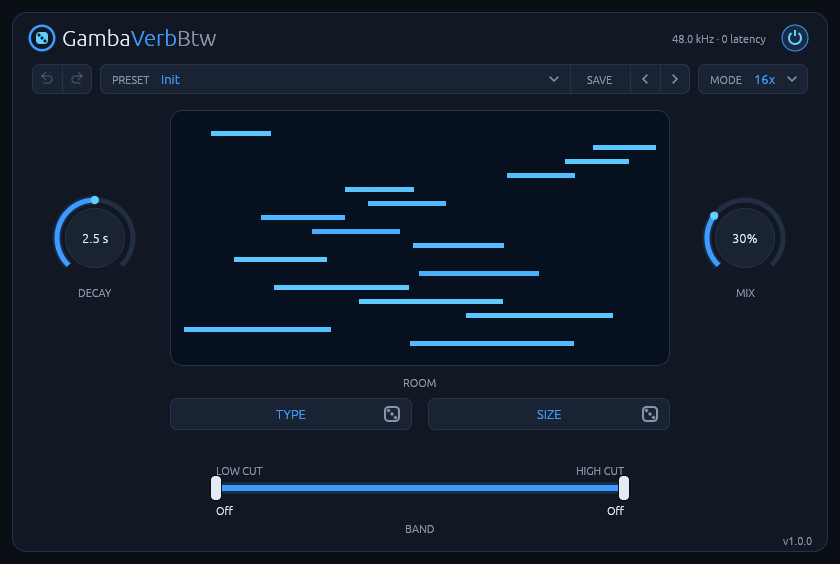

# GambaVerbBtw

**A room reverb for Linux whose rooms come from two short codes.**
CLAP and VST3 for Linux.



GambaVerbBtw doesn't aim for the smooth, polished tail of a classic algorithmic reverb. It builds the
resonances of a real room: 16 or 32 delay lines feed back into each other, and you hear early
reflections and the room's own ring. Click TYPE or SIZE to roll a new room, and save the one you like
as a preset. The same codes in the same mode always give the same room, on every machine.

It runs natively on Linux, with no network access and no telemetry.

**[Read the manual](manual.md)** for every control and how to use it.

## Features

- **Rooms from codes:** two six-character codes, about 10¹⁸ rooms in each mode.
- **Two modes:** 16x, or 32x for a denser, smoother tail at about twice the CPU.
- **DECAY is the real reverb time:** 0.2 to 20 s, measured at 500 Hz.
- **The band filters only the reverb;** the dry signal is never touched.
- **Presets, and undo and redo for the room.**
- **Zero latency.** About 0.2% of one core in 16x, 0.45% in 32x (stereo drums at 48 kHz, i7-14700K).

## Install

Download the latest version from the [Releases page](https://github.com/rmnhofma/GambaVerbBtw-release/releases),
or with these commands:

```bash
curl -LO https://github.com/rmnhofma/GambaVerbBtw-release/releases/download/v1.1.3/GambaVerbBtw-1.1.3-linux-x86_64.tar.gz
curl -LO https://github.com/rmnhofma/GambaVerbBtw-release/releases/download/v1.1.3/GambaVerbBtw-1.1.3-linux-x86_64.tar.gz.sha256
sha256sum -c GambaVerbBtw-1.1.3-linux-x86_64.tar.gz.sha256 && tar xzf GambaVerbBtw-1.1.3-linux-x86_64.tar.gz
cd GambaVerbBtw-1.1.3-linux-x86_64
```

Install for your user:

```bash
mkdir -p ~/.clap ~/.vst3
rm -f ~/.clap/GambaVerbBtw.clap && cp GambaVerbBtw.clap ~/.clap/
rm -rf ~/.vst3/GambaVerbBtw.vst3 && cp -r GambaVerbBtw.vst3 ~/.vst3/
```

Or for all users:

```bash
sudo mkdir -p /usr/lib/clap /usr/lib/vst3
sudo rm -f /usr/lib/clap/GambaVerbBtw.clap && sudo cp GambaVerbBtw.clap /usr/lib/clap/
sudo rm -rf /usr/lib/vst3/GambaVerbBtw.vst3 && sudo cp -r GambaVerbBtw.vst3 /usr/lib/vst3/
```

Removing the old copy first avoids overwriting a file a running host has loaded. Then rescan plugins
in your DAW.

To uninstall:

```bash
rm -rf ~/.clap/GambaVerbBtw.clap ~/.vst3/GambaVerbBtw.vst3
```

## Requirements

- Linux x86-64 with glibc 2.31 or newer (Ubuntu 20.04, Debian 11, Fedora 32 and newer)
- A CLAP or VST3 host
- X11 or XWayland, and a Vulkan driver for the editor

Releases contain the CLAP and VST3 plugins only.

## License

MIT, see [LICENSE](LICENSE). The licenses of the third-party code in the binaries are in
`THIRD-PARTY-LICENSES.txt` in each release archive.

VST is a registered trademark of Steinberg Media Technologies
GmbH. CLAP is an open standard by the free-audio project. GambaVerbBtw is an
independent project. It isn't affiliated with or endorsed by Steinberg or by
u-he, whose Protoverb inspired its approach.
