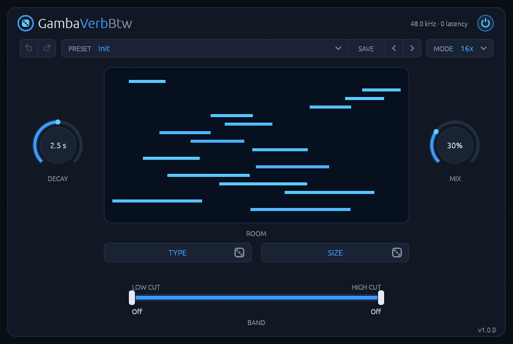
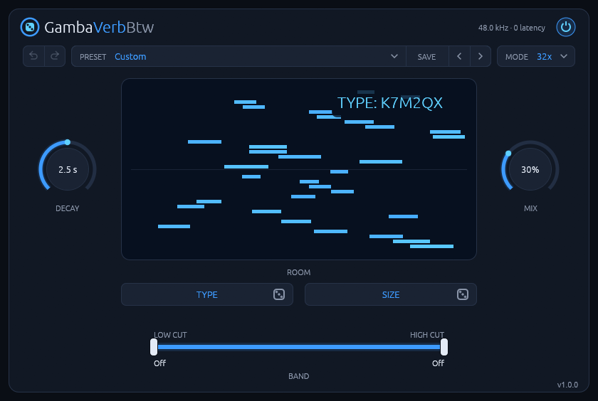
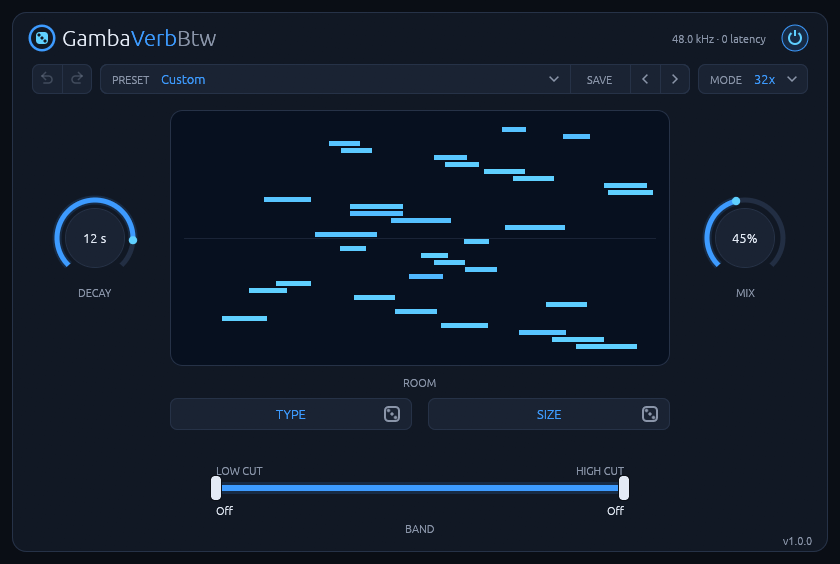
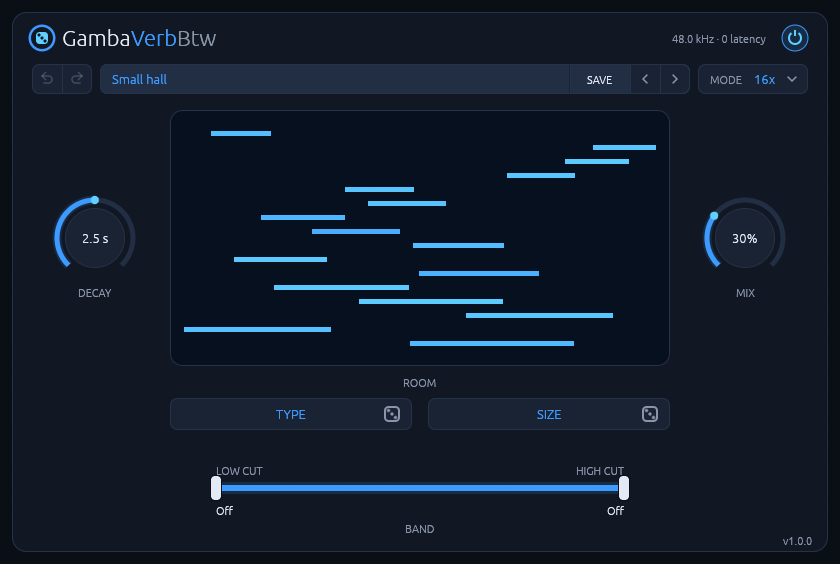

# GambaVerbBtw manual

**A room reverb for Linux whose rooms come from two short codes.**

Version 1.1.3. To install it, see the [README](README.md).

## Getting started

1. Put GambaVerbBtw on a track or a return. It starts on the **Init** room, a medium room.
2. Set MIX to taste. On a return track, 100% gives you only the reverb.
3. Click **TYPE** or **SIZE** until a space sounds right for the part.
4. Click **SAVE** and give the room a name.



## The controls

| Control | Range | Default | What it does |
| --- | --- | --- | --- |
| **Power switch** (top right) | On / Off | On | Crossfades to the dry signal over 20 ms. While off, the reverb stands still; switched back on, its tail starts from silence. The status line reads `bypassed`. |
| **↶ ↷** (top left) | | | Undo and redo changes to the room. |
| **PRESET** (top row) | Init and your presets | Init | Sets TYPE, SIZE, MODE and DECAY. Reads `Custom` when the current room and DECAY match no preset. |
| **SAVE** (top row) | | | Saves the current TYPE, SIZE, MODE and DECAY under a name. |
| **‹ ›** (top row) | | | Step through the presets. |
| **Mode** (top row) | 16x, 32x | 16x | How many delay lines the room has. |
| **Decay** | 0.2 to 20 s | 2.5 s | The reverb time at 500 Hz. The knob's middle is 2.5 s. |
| **Mix** | 0 to 100% | 30% | Dry/wet balance, equal-power. At 0% the output is the input, bit for bit. |
| **Type** | a code | `0000BK` | The room's shape, stereo layout and wall material. Click to roll a new code. |
| **Size** | a code | `00000A` | The room's size and line lengths. Click to roll a new code. |
| **Low cut** (BAND, left handle) | 20 Hz to 20 kHz | Off (20 Hz) | High-pass on the reverb only. |
| **High cut** (BAND, right handle) | 20 Hz to 20 kHz | Off (20 kHz) | Low-pass on the reverb only. |

**Mouse:** drag a knob up or down, and hold Shift for fine control. Double-click a knob to
reset it.
Drag the BAND handles sideways; they stay at least 1.25× apart, and a double-click resets one.

DECAY, MIX and the cuts are host parameters for automation. The codes and the mode are not, but they
are saved with the project and in DAW presets. Clicking the logo opens [the plugin's page](https://rmnhofma.github.io/plugins/gambaverbbtw/).

## How to use it

### Rolling a room

**TYPE** picks the room's shape: one room or two or four coupled rooms, how its reflections spread
across the stereo field, and one of four wall materials. **SIZE** picks how big it is, with an
average line length from 6 to 60 ms.

Click either one to roll a new code. It shows for a moment at a random place in the display, as
`TYPE: K7M2QX`. Keep rolling SIZE to try the same kind of room bigger and smaller, or TYPE to try
other walls and shapes at the same size. DECAY, MIX and the band stay where you put them.



A change of room is click-free: the new room plays at full level while it fills, and the old one
rings out over 0.12 × DECAY (0.1 to 3 s). At long DECAYs a change you make in the meantime waits
for it.

The codes use `0-9` and `A-Z` without I, L, O and U.

### 16x or 32x

MODE is the number of delay lines. 32x has twice the modes per hertz and a denser, smoother tail,
for about twice the CPU. A code keeps its size,
walls, stereo layout and number of rooms in both modes, but they are different rooms, so try both on
a room you like.



### Decay and the walls

DECAY is the reverb time at 500 Hz. The walls make the highs die faster: the time at 5 kHz is 0.61,
0.41, 0.26 or 0.16 times DECAY, depending on the material. Short rooms with dark walls stay a little
brighter than their material.

The walls also take some level: at DECAY 2.5 s, white noise comes out 2 to 7 dB below its own level,
so a dark room sounds quieter than a bright one. Adjust MIX to match. Longer DECAYs are louder, as in
a real room.

### Band

LOW CUT and HIGH CUT shape only the reverb. Use LOW CUT to keep the room out of the kick and bass,
and HIGH CUT to push it behind the source.

### The display

The room is drawn as its 16 or 32 lines, by length and stereo position, each lit by its live level
as MIX lets it through. It's brightest at DECAY 20 s and MIX 100%.

### Presets

A preset holds TYPE, SIZE, MODE and DECAY, nothing else, and is shared by every project and both
formats. MIX and the band stay yours.

**SAVE** turns the PRESET menu into a name field holding the current preset's name. Type a name and
press Enter (or click SAVE again) to save. Escape or a click elsewhere cancels. Saving under an
existing name replaces that preset. `Init`, an empty name and names with a slash can't be saved.



Presets are files in `~/.local/share/GambaVerbBtw/presets/` (or under `$XDG_DATA_HOME`), one per
preset, named after it and ending in `.preset`:

```text
model = K7M2QX
delay = 4HD9RA
mode = 32x
decay = 3.7
```

In the file, `model` is TYPE and `delay` is SIZE. You can copy, edit or delete these by hand, and a
preset file is how you use **a code someone shared with you**: the editor only rolls codes. Files
ignore case and read `O` as `0` and `I` or `L` as `1`. A file without a `mode` line is 16x, and one
without a `decay` line leaves DECAY as it is. The menu holds Init and 27 presets, in name order.

### Undo and redo

The two arrows left of PRESET undo and redo changes to the room: each change of TYPE, SIZE or MODE
is one step, whether you made it or chose a preset, and undo puts both codes and the mode back. So
rolling is safe: if you just passed the room you wanted, go back.

A preset's DECAY isn't undone with them; DECAY, MIX and the cuts are parameters, so your DAW's undo
covers them. There are no keyboard shortcuts (Ctrl+Z stays with your DAW). The last 100 steps are kept
while the plugin is loaded, also while its window is closed, but they aren't saved with the project.

## Good to know

- **Latency:** zero. Nothing needs compensating.
- **Mono tracks get a stereo room:** on a mono source, the tail's left and right channels correlate
  less than 0.5 for every stereo layout.
- **Tail:** the plugin reports 3 × DECAY to the host while there's sound in the reverb.
- **CPU:** about 0.2% of one core in 16x and 0.45% in 32x (stereo drums at 48 kHz, i7-14700K). While
  both rooms of a change run, it rises by about half. Once it has rung out to digital silence, it
  costs almost nothing.
- **Audio:** stereo in and out, or mono in and stereo out, at whatever sample rate the host uses.
- **Hosts:** tested in Bitwig Studio. Other CLAP or VST3 hosts should work but haven't been tried; some
  hosts keep keystrokes for themselves, and then a preset can't be named in the editor.
- **Display:** X11, or XWayland on a Wayland desktop, with a Vulkan driver.

## Troubleshooting

- **Typing a preset's name does nothing:** some hosts keep keystrokes for themselves. Write the
  preset file by hand instead (see [Presets](#presets)).
- **A preset doesn't show up in the menu:** its file must end in `.preset`, have `model` and `delay`
  lines with valid codes, and its name can't start with a dot. The menu shows the first 27 presets
  in name order. The editor reads the folder when it opens and after a save, so reopen the editor
  after adding files by hand.
- **The room changes a moment after I roll a code:** at long DECAYs the old room rings out first (up
  to 2.4 s at DECAY 20 s), and a change made meanwhile waits for it.
- **Two rooms differ in level:** the walls' materials take 2 to 7 dB of the highs at DECAY 2.5 s, so a
  dark room sounds quieter than a bright one. Adjust MIX.
- **The plugin doesn't show up:** check that the bundle is in `~/.clap`, `~/.vst3`,
  `/usr/lib/clap` or `/usr/lib/vst3`, then rescan plugins in your DAW.
- **The editor window stays black or doesn't open:** check that a Vulkan driver is installed.
  The `vulkaninfo` tool from `vulkan-tools` should list your GPU. Bitwig Studio writes plugin
  errors to `~/.BitwigStudio/log/engine.log`.
